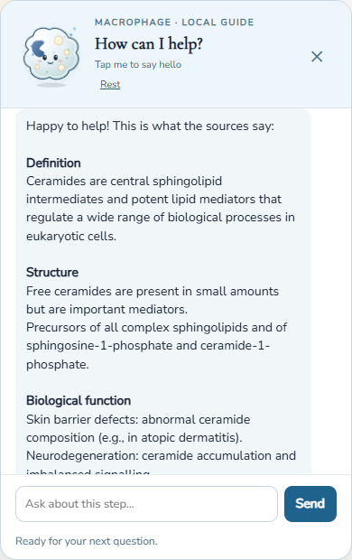
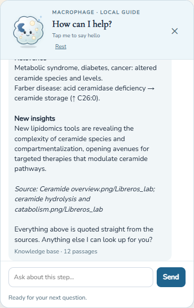
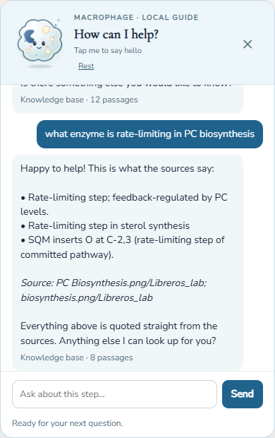

# Companion knowledge base — report

Branch `Mods-anapau` · author: Ana Pau Salcedo · for review by Gerardo Barcia

## What changed, in one paragraph

The companion no longer improvises. It answers only from a knowledge base made of the files we feed it. For now
that is the folder *Global Lipids Overview and Functions* (80 infographic slides, a title slide and two tables).
If the base does not hold enough evidence, the answer is exactly `I have no information about this.`
Nothing in the statistics, the pipeline or the plots is touched by this feature.

## What an answer looks like

For a question about a topic the answer is a short synthesis in fixed sections: **Definition, Structure,
Biological function, Interactions** (only when the sources have it), **Relevance, New insights**. The section titles
are bold and the source line is italic. The source is cited as `<file name>/Libreros_lab`.




A specific question gets its best two or three lines and the source:



A question the files do not cover gets the fixed sentence, followed by a friendly line that adds no fact:


## How it works (no language model)

1. The question is reduced to its content words and the passages are ranked (BM25).
2. A passage is eligible only if it holds enough of the question's words, and those words meet inside one line.
3. Lines are sorted into the sections by the heading they sit under and by the words they use; the best one or two
   per section are kept.
4. Every line is copied unchanged from a file. Nothing is reworded, so nothing can be said that is not in a source.

Consequence: the answer reads as a tidy list of the files' own sentences, not as flowing prose. Fluent prose would
need a language model restricted to the retrieved passages, which sends the text to an outside provider and breaks the
"nothing leaves the database" guarantee. It is not built.

## Feeding it

```
Rscript 03_COMPANION_KNOWLEDGE.R add path/to/file_or_folder
Rscript 03_COMPANION_KNOWLEDGE.R list
Rscript 03_COMPANION_KNOWLEDGE.R ask "what is a ceramide"
```

Supported: `.md .txt .docx .pdf .csv .tsv .xlsx`. Images are transcribed word for word to Markdown (no OCR) and cite
the image they came from. Full details: `knowledge_base/README.md`.

## Settings (environment variables)

| Variable | Default | Effect |
| --- | --- | --- |
| `LIPIDOMIC_COMPANION_KB` | on | `0` restores the previous scripted companion |
| `LIPIDOMIC_KB_DIR` | `knowledge_base/library` | where the fed files live |
| `LIPIDOMIC_KB_STYLE` | `digest` | `passages` gives longer answers made of whole passages |
| `LIPIDOMIC_KB_FRIENDLY` | on | `0` removes the greeting and closing lines |
| `LIPIDOMIC_KB_ORIGIN` | `Libreros_lab` | second part of the source label |
| `LIPIDOMIC_KB_SEARCH_SEED` | `0` | `1` also searches the app-guidance seed |

## Files

- `R/companion_kb.R` — engine (extraction, index, search, digest)
- `R/companion_assistant.R` — grounded branch before the AI branch
- `www/team/js/companion_assistant.js` — bold titles and italic source (DOM nodes, no HTML parsing)
- `03_COMPANION_KNOWLEDGE.R` — command line to feed and test
- `knowledge_base/` — README, app-guidance seed; the library itself is git-ignored (articles may be copyrighted)
- `tests/dual-ui/test_companion_kb.R` — feeding, verbatim answers, refusals, audience, injection safety, digest

## Known limits (please review)

- The Glucosylceramide overview image is empty (0 bytes) and is missing from the base.
- Seven slides contain `[illegible]` words; transcriptions of small print need a spot check against the images.
- Section assignment is heuristic: a line can land in a slightly odd section (for example an abbreviation key under
  Relevance).
- The base also holds a published table (Nagata); it is cited like every other file.
- Questions must be in English, like the sources.
