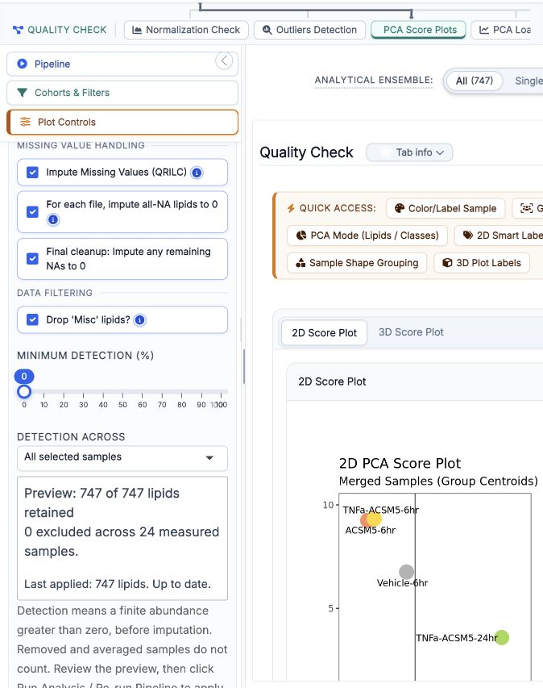
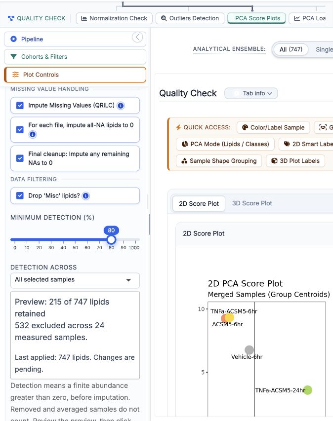
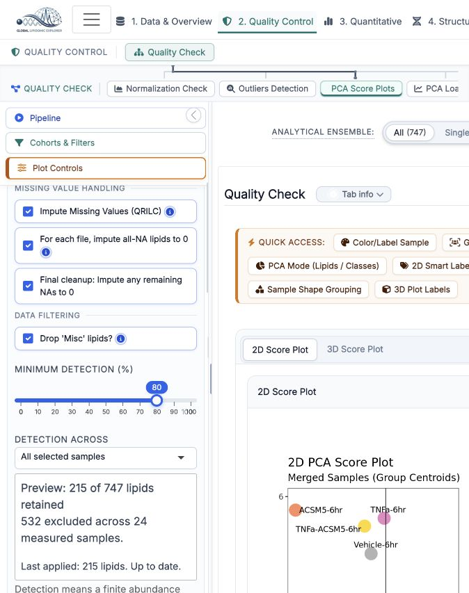

# Block 2: shared preparation state and detection filtering

Draft integration for Max's review. Branch: `integration/shared-preparation-qc`.
Base: Block 1 (`integration/libreros-guided-workflow`, `06baf3a9ea776b581ed6f8f817921dedf7f020cb`).
This is a stacked change, separate from PR #2's reference/metadata proposal. It changes neither `main` nor the deployed team application. Retarget after Block 1 is merged; do not merge this branch into main before its baseline is accepted.

## What changes

The shared data hub now captures an immutable preparation request: matrix identity, existing metadata identity, selected samples, detection settings, imputation/normalization settings, outlier treatments, averaging, and fixed QRILC seed 42. Each successful explicit run records the applied request, filter audit, output IDs and revision in session-local state. Downstream modules continue to consume the hub's existing matrix interface.

- **Preview first:** minimum detection starts at **0%**, with `dropNonDetected = FALSE`. These defaults keep all rows and preserve Classic numerical results. The QC sidebar previews retained/excluded counts before imputation.
- **Explicit application:** changes to preparation settings and selected samples remain pending until **Run Analysis / Re-run Pipeline**. This intentionally replaces automatic recomputation on normalization/imputation changes and needs UX acceptance from Max.
- **Independent QC actions:** confirmed outlier actions recompute with the last applied preparation settings plus the new treatment list. A pending threshold or normalization cannot be silently adopted by removing a sample. Explicit removal still wins over global averaging, as in Block 1.
- **Clear provenance:** existing results remain available while compatible settings are pending, with a visible warning. A changed matrix, changed confirmed metadata, or failed computation hides incompatible/stale results. An empty selection means no samples, never all samples.
- **Consistent QC context:** normalization reports and the before-normalization plot use the applied method, sample selection and per-file zero handling, even while controls have pending edits.
- **Consistent exports:** before/after-QC CSV and matrix ZIP exports use the applied request. Session ZIP export is blocked with an explanatory notification if an existing run has pending/invalid preparation changes; apply or revert first. The existing session ZIP schema is unchanged. Runtime revision history is not persisted in ZIP in this block.

Detection means finite raw abundance greater than zero. Filtering runs before per-file zero handling, QRILC, normalization and synthetic averaging. Removed/averaged samples are excluded from the detection denominator. Threshold boundaries are inclusive. Optional group detection retains a lipid if it meets the threshold in at least one existing Group1 × Group2 group; it requires confirmed, complete group metadata and does not introduce the proposed metadata schema. Active filters retaining fewer than two lipids fail visibly.

PCA display settings, annotation logic, BQC downstream filters and statistical methods retain their existing behavior; they are not part of the new preparation transaction. This is a scoped preparation/QC foundation, not a claim that every setting in the entire app is transactional.

## Evidence

All computation ran in an isolated checkout/process on the RTX machine, using R 4.4.3. Only synthetic fixtures and the repository's public demo workbook were used. No human study data or credentials are included.

| Check | Result | Evidence |
|---|---|---|
| Production helpers and Shiny state scheduler | 39 checks pass | [State/filter checks](block2-evidence/state-filter-checks.csv) |
| Actual shared hub, CSV ingestion, bridge, run buttons and real CSV/ZIP download handlers | 15 checks pass | [Hub checks](block2-evidence/hub-checks.csv) |
| Candidate and frozen guided engine vs pinned main, 3 normalizations × 2 imputation settings, preparation/limma/Wilcoxon | 36 comparisons pass; maximum absolute difference **0** | [Parity](block2-evidence/upstream-guided-parity.csv) |
| Seeded repeatability and reversed contrasts | 18 preparations repeat identically; 18 contrast reversals preserve p-values and invert fold-change | `tests/integration/compare_versions.R` |
| Max's reference artifacts and production engines | 19 required comparisons match; 1 expected PCA transformation difference remains disclosed | [Reference comparison](block2-evidence/reference-parity.csv) |
| Independent arithmetic and method-routing checks | 7 arithmetic + 3 routing checks pass | [Arithmetic](block2-evidence/arithmetic-oracles.csv), [routing](block2-evidence/routing-checks.csv) |
| Existing regression suites | 6 existing suites + Block 1 safeguards pass | [Run manifest](block2-evidence/regression-runs.json) |
| Browser, public demo | 747 applied at defaults → 80% preview: 215 retained / 532 excluded → explicit rerun: 215 applied | Screenshots below |

Candidate preparation vs the regenerated proof has maximum absolute difference **0**. Committed CSV artifacts round decimal values: comparison uses relative/scaled tolerance `1e-10`, dimensions/IDs and missing-value masks, rather than claiming byte equality. The maximum absolute discrepancy in the committed transformed abundance CSV is about `2e-6` at large abundance values. The known PCA comparison uses `log2(x)` in the proof versus `log2(x + 1)` in production; with identical transformation the scores match exactly. Annotation disagreements previously documented in PR #2 remain unchanged (469 subclasses, 409 double-bond counts on the public fixture).

The actual-hub test records four existing min/max warnings while annotation controls initialize without values. These are disclosed in the local full log; no claim of a console-warning-free or full-app audit is made. The existing ZIP roundtrip suite is a simulation; real browser ZIP restoration across all controls is not claimed by this block. Physical-phone testing remains deferred.





These screenshots show the isolated **Classic** integration preview, not the deployed guided app.

## Reproduce

From the repository root, with application dependencies installed:

```sh
Rscript --vanilla tests/block2/test_preparation.R block2-evidence
Rscript --vanilla tests/block2/test_hub.R block2-evidence
Rscript --vanilla tests/block2/compare_references.R block2-evidence/reference
Rscript --vanilla tests/test_integration_safeguards.R
```

For the upstream/guided comparison, extract pinned main (`d48933ca20e59e67def18f29bc3cf035b81e1ca2`) into a separate directory and pass that directory to:

```sh
Rscript --vanilla tests/integration/compare_versions.R /path/to/pinned-main block2-evidence/parity
```

GitHub Actions runs focused state/filter tests, the existing lightweight suites, Block 1 safeguards and both parity harnesses, retaining generated artifacts. The full-dependency actual-hub test and six-suite application regression were run separately on the isolated RTX checkout. [Source hashes](block2-evidence/source-sha256.csv) and [R environment](block2-evidence/sessionInfo.txt) identify the tested code and numerical runtime.

## Review decisions / remaining work

- [x] Implement shared pending/applied request state and revision history.
- [x] Integrate raw detection filtering with Classic defaults and visible preview.
- [x] Prevent QC/navigation/exports from silently applying unrelated pending preparation changes.
- [x] Run synthetic, actual-hub, reference and upstream/guided comparisons.
- [x] Inspect preview and explicit application in a browser; preserve screenshots.
- [ ] Max: accept the explicit-run UX for Classic, proposed group-filter semantics and pending-session-ZIP guard.
- [ ] Max: agree final common metadata fields, ID matching, paired/longitudinal identity and validation policy (PR #2).
- [ ] Max: agree annotation source/precedence and how to communicate unresolved annotations (PR #2).
- [ ] Max: choose/document the canonical PCA transform; no PCA numerical change here.
- [ ] Agree a versioned persistence contract for preparation history before serializing it across app versions.
- [ ] Integrate the guided frontend against this shared interface after review; do not deploy this draft.
- [ ] Broader browser ZIP restoration and physical-phone test remain separate follow-ups.
